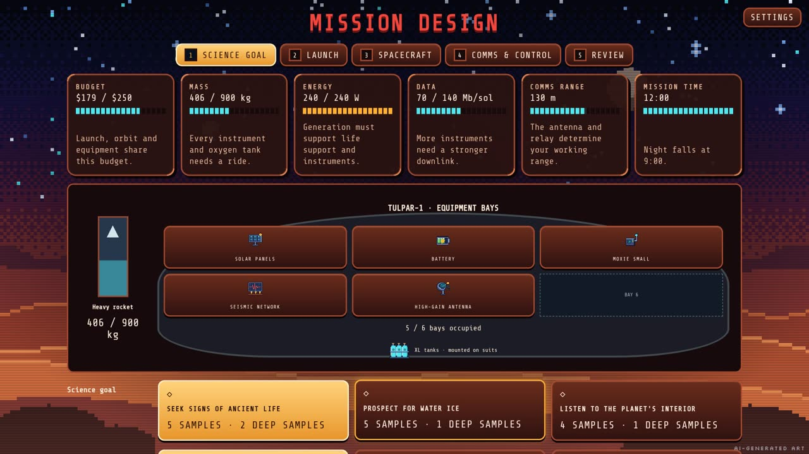
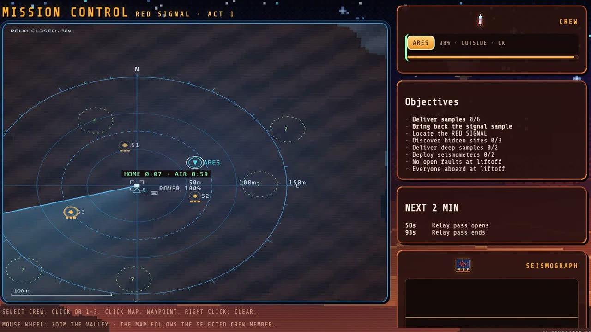
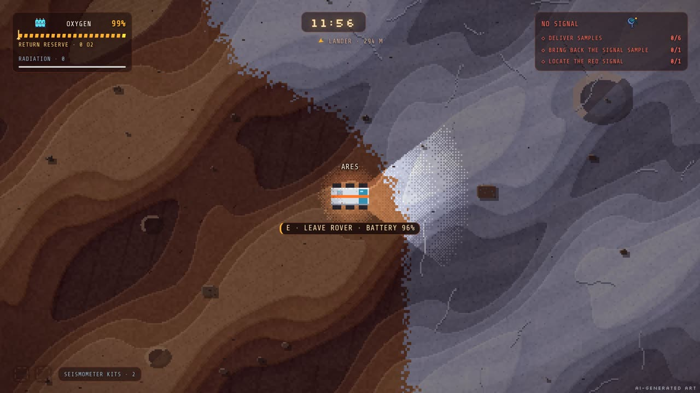
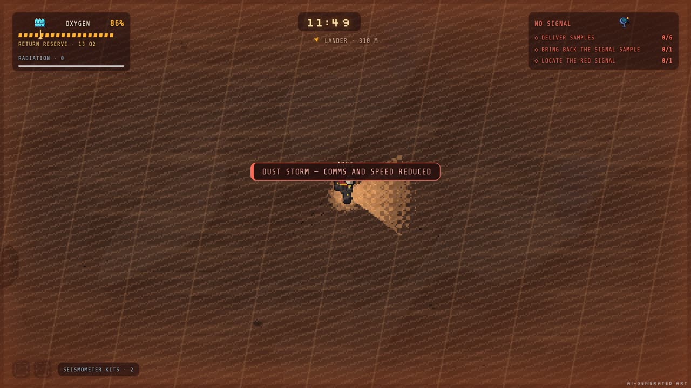
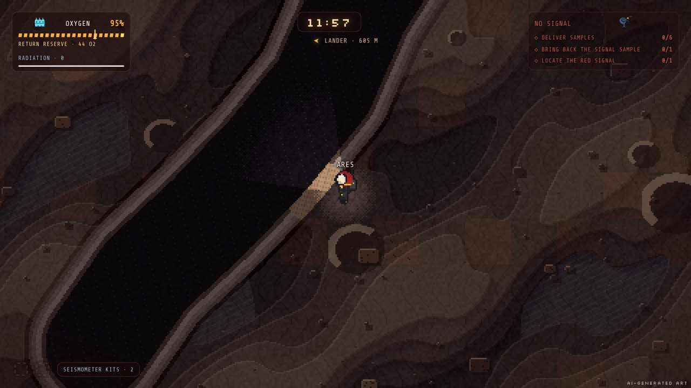

# RED SIGNAL

**Design the mission. Then survive it.**

A cooperative Mars mission design game for 1–4 players, built for the
**NASA Space Apps Challenge 2026** (challenge: *Space Mission Design Game*).

| | |
| --- | --- |
| ▶ **Play now (solo, in the browser)** | https://nurmukasan.github.io/Nasa-Space-App-Challange/ |
| 🎬 **30-second demo video** | [`media/red-signal-promo-30s.mp4`](media/red-signal-promo-30s.mp4) |
| 🌐 **Online multiplayer server** | http://redsignal0aaf5d.centralindia.cloudapp.azure.com (temporary event server) |
| 📄 **Game design and science** | [`docs/product-logic.md`](docs/product-logic.md) · [`docs/REFERENCES.md`](docs/REFERENCES.md) |



## What it is

A team first **designs a Mars sample-return mission** under real engineering trade-offs, then
**lives through that mission in real time** and finds out what their decisions actually caused.

1. **Mission design.** Five steps: science goal → launch → spacecraft → comms & control → review.
   Choose a landing site (Jezero Crater, Elysium Planitia, Arcadia Planitia), a rocket, a relay
   orbit and up to six equipment bays (solar panels, RTG, battery, MOXIE oxygen plant, drill,
   seismic network, ground radar, antenna…). Six live gauges — budget, mass, energy, data,
   comms range, mission time — and a forecast show when power or oxygen will run out.
2. **The flight.** Roles are asymmetric, so the crew has to talk:
   - **EVA astronauts** see the terrain but not the map. They walk, drive the rover, dig samples,
     deploy seismometers, shelter in lava tubes and refill oxygen at supply caches.
   - **Mission Control** sits in the lander. It sees the map, radar and seismograph but not the
     world. It manages oxygen, power and comms, classifies quakes, places waypoints and locates
     epicentres with range rings, the way InSight located marsquakes with a single station.
   - **Solo** plays both roles.
   - Crew specialties: Engineer (faster repairs), Scout (faster walking), Geologist (faster digging),
     Biologist (more valuable samples).
3. **The after-action report** links outcomes back to design choices ("power failed at dusk
   *because* the mission flew on solar panels only"), hands out crew awards and offers
   **Redesign** or **Fly again**.

| Mission | Length | What happens |
| --- | --- | --- |
| **Sol 1 · First Steps** | 4 min | Guided training: the suit, oxygen, reading the ground, two samples home |
| **Sol 47 · RED SIGNAL** | 12 min | Story mission in a 5.6 km valley with five biomes (plains, delta, dunes, ice, lava), lava tubes, a rover and oxygen caches. A repeating seismic signal must be located and its source recovered before the launch window closes |
| **Free Mission** | 10 min | Classic expedition: explore every known site and meet the science goal |

Events during a flight: marsquakes with rockfalls, meteoroid impacts that expose ice, dust devils that
clean (or not) the panels, dust storms, sunset and night, MOXIE and antenna faults, a solar flare, comms
blackouts. Optional **personal assignments** give each player two milestones tailored to their role.

| Mission Control | Rover in the ice field |
| --- | --- |
|  |  |
| **Dust storm** | **Lava tube** |
|  |  |

## How to play

1. Open the game, type a call sign.
2. **Create room** and share the 4-letter code, or **Play solo (offline)**.
3. Pick roles (one Mission Control and at least one astronaut, or Solo) and a specialty.
4. Pick a mission → **Quick start**, or **Design mission** to build your own.

| Key | Action |
| --- | --- |
| `W A S D` | Walk or drive the rover |
| `Shift` | Run (uses more oxygen) |
| `Space` | Dig (in training and RED SIGNAL, strike the timing bar) |
| `E` | Context action: airlock, rover, repair, supply cache, deploy a seismometer |
| `1`–`6` | Radio pings to Mission Control (ok, help, low O2, returning, found, shaking) |
| `Tab` | Switch to Mission Control (Solo) |
| Mouse wheel | Zoom the Mission Control map |

## Science behind the game

Every mechanic is tied to a real NASA mission or dataset (full table and honest simplifications:
[`docs/product-logic.md`](docs/product-logic.md), section 13).

| In the game | Real basis |
| --- | --- |
| Quake, impact and dust-devil signals; epicentre from range rings | NASA **InSight** seismology and its single-station marsquake location |
| Impacts that expose ice | InSight-detected meteoroid impact of December 2021 |
| Oxygen plant limits | **MOXIE** on Perseverance |
| Solar-flare radiation dose | **RAD** on Curiosity (May 2024 flare) |
| Soft sand, panel-cleaning dust devils | **Spirit** and **Opportunity** |
| Orbital anomalies | **HiRISE** on Mars Reconnaissance Orbiter |
| Delta samples, ground radar | **Perseverance** at Jezero, RIMFAX |
| Liftoff with samples | **Mars Sample Return** concept |

Honest simplifications: time is compressed about 15×, RED SIGNAL itself is fictional, and masses,
prices and power are game units that keep real proportions.

## Built with

TypeScript monorepo · Node.js 22 · Express + Socket.IO (authoritative server, 15 Hz) · React + Zustand ·
Phaser 3.90 (pixel-art field view, chunked 5.6 km world) · Vite · Vitest (339 unit, integration and
headless-bot soak tests) · GitHub Actions (CI and GitHub Pages) · Microsoft Azure (multiplayer server).

The same deterministic engine runs on the server and, in solo mode, fully inside the browser.

## Run it locally

Requirements: Node.js 22 or newer.

```bash
npm ci
npm run dev        # server http://localhost:3001, game http://localhost:5173
```

Open two browser tabs on http://localhost:5173, create a room in one, join with the code in the other.
"Play solo (offline)" runs the whole game inside the browser with no server.

## Scripts

| Command | What it does |
| --- | --- |
| `npm run dev` | Server and client with hot reload |
| `npm run check` | Format check, type check, tests, production build (CI runs this) |
| `npm test` | Unit and integration tests |
| `npm run build` then `npm start` | Production: one Node process serves the game and the sockets |
| `npm run bots -- --code ABCD --n 2` | Headless test players |

Add `?debug=1` to the URL to get `window.rs` (send, store, snaps) in the browser console.

## Structure

- `shared/` – game rules: types, protocol, balance, catalog, simulation, room engine. Pure TypeScript.
- `server/` – thin Socket.IO wrapper around the engine.
- `client/` – React UI, Phaser field view, canvas Mission Control console.
- `tools/` – headless bots, soak tests, art tools, Azure server scripts.
- `docs/` – product logic, architecture, work plan (`phases.md`), asset guide (`assets.md`), references.
- `media/` – demo video and screenshots.

## Deploy

- **GitHub Pages** publishes the static solo build through `.github/workflows/pages.yml` after each
  push to `main`. Pages serves solo play; online rooms need the Node server.
- **Azure VM** (used for the event): `tools/azure-vm.sh`, run in Azure Cloud Shell, finds a region and
  VM size the subscription allows, installs Node 22, builds `main` and runs the server on port 80 as a
  systemd service. `tools/azure-autoupdate.sh` makes the VM pull and rebuild `main` every 5 minutes
  when no room is open.
- **Render**: the included `render.yaml` Blueprint.
- **Any Node host**: `npm ci --include=dev && npm run build`, then `NODE_ENV=production npm start` with
  Node 22 and WebSocket support. `npm start` serves both the client and Socket.IO on `PORT`.
  Production disables debug commands. Health check: `/healthz`. Free services may sleep: warm the
  service before a demo.

## Use of AI

AI assistants were used to help write and review code and to create some of the art in this
repository; screens that show AI-made art carry a visible "AI-GENERATED ART" label.
OpenAI Codex assisted with client foundation recovery, mission control, mission design, networking,
scene lifecycle fixes, field effects, causal report UI, integration checks and deployment setup.
OpenAI Codex also designed and implemented opt-in personal assignments: seeded, crew-scaled
task chains, authoritative progress, handoffs, field guidance and contribution reports
(`docs/personal-tasks.md`).
Claude Code assisted with the remote-interpolation correction in PR #1.
Claude Code drew the 18 pixel-art constructor icons (modules, launch vehicles, relays) in code,
and they are used in the mission design screen.
Claude Code also drew the pixel-art Mars backdrop of the menu screens and restyled the menu UI.
Claude Code also assisted with the v2 game design and work plan
(`docs/phases.md`, `docs/product-logic.md`, `docs/architecture.md`, `docs/assets.md`) and the asset validator.
Claude Code also assisted with v2 engine and Mission Control work: epicentre location, event director,
RED SIGNAL, lander faults, solar flare, crew awards and report findings, the mission forecast and the
"what's ahead" console feed.
Claude Code drew the four crew class sprites (engineer, scout, geologist, biologist) in code
(`client/src/game/crewArt.ts`), modelled on AI-generated reference sheets from the team, and added the
class picker and class perks.
The lander interior is built from the team's AI-generated tileset and base reference
(`assets/raw/`): Claude Code wrote the slicing and map tools (`tools/art/`), cut the sheet into a
sprite atlas and 64-px tiles, laid out the Tiled map `client/src/game/interior/data/base.tmj` after the
reference, and added collisions, sliding doors, room actions and the ARIA assistant's talking face and
alarm screen on top of it (`client/src/game/interior/`).
The 30-second promo video (`media/red-signal-promo-30s.mp4`) mixes real in-engine gameplay with
AI-generated material: two still images made with Higgsfield (Nano Banana Pro) and the English
voice-over made with Higgsfield (Seed Audio 1.0). Both AI images carry a visible "AI-GENERATED IMAGE"
label in the video and the end card states that it contains AI-generated imagery and voice. Claude Code
captured the gameplay, retouched the images (removed generated flag and patch details), synthesized the
music and sound effects in code, and edited the video.
Claude Code drew the shared in-base action animations (console work, watering plants, talking to
ARIA, sitting, sleeping) for every crew class.
Claude Code added the start screen and lobby motion (`client/src/ui/menuMotion.css`), following the
open design skills impeccable (`animate`) and Anthropic's `frontend-design`.
The built-in fallback sprites and sounds are procedural; NASA audio is not bundled.
Additional asset contributions must be credited by their authors before submission.

## Data and references

NASA data and resources, fonts, libraries, tools and their licenses: [`docs/REFERENCES.md`](docs/REFERENCES.md).
No NASA logos, flags or mission emblems are used anywhere in the game or the video.

## Team

Built by our team for NASA Space Apps Challenge 2026.
